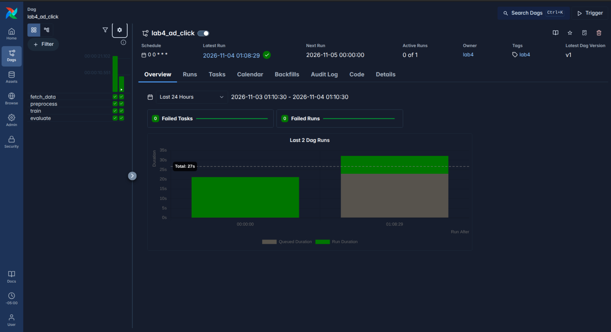
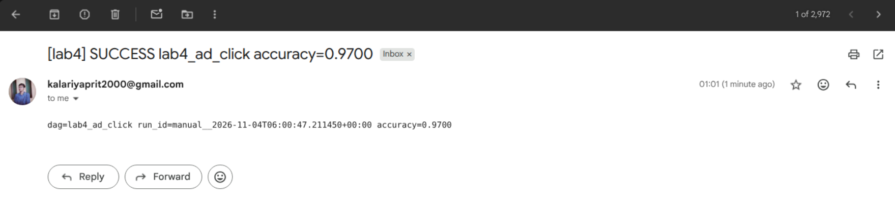

# Lab 4: Airflow 3 in Docker Compose, on a VM

The course lab `Labs/Airflow_Labs/Lab_3` (standalone Airflow 2 on a cloud VM, a LogisticRegression DAG, a Gmail success email) rebuilt as Airflow 3.3.2 in Docker Compose with LocalExecutor and Postgres. The DAG separates transient failures (retried) from permanent ones (not retried), alerts by Gmail SMTP with the credential held in an Airflow Connection, and the same stack runs on a throwaway GCP VM that is reached only through an SSH tunnel.

## 1. What I changed

| | Original (Lab_3) | Mine | Why |
|---|---|---|---|
| Deployment | Standalone Airflow in a venv on a VM, started by hand in two terminals, ports opened in the firewall | Docker Compose project `lab4-airflow`, one command to start, the same files run locally and on the VM | Reproducible, and nothing is installed on the host |
| Executor and DB | Default SQLite and `SequentialExecutor` | LocalExecutor with Postgres 16.15 (named volume, `pg_isready` healthcheck) | SQLite cannot run tasks in parallel and is not meant for a real deployment |
| Airflow version | Airflow 2 (`apache-airflow`, unpinned) | Airflow 3.3.2 on Python 3.12, installed under the official constraints file, every dependency pinned with `==` | Lab_3's APIs are Airflow 2 only, and an unpinned install is not repeatable |
| API auth | `auth_backend = basic_auth` in `airflow.cfg` | FAB auth manager. `airflow users create` still exists. The REST API takes a JWT from `POST /auth/token` | Airflow 3 dropped basic auth on the REST API |
| DAG style | Classic operators, `provide_context`, Airflow 2 imports | TaskFlow with `airflow.sdk` imports: `fetch_data`, `preprocess`, `train`, `evaluate` | Current Airflow 3 API. The data path is no longer hard-coded to `/home/mlops_fall_2024` |
| XCom | numpy tuples through pickled XCom (`enable_xcom_pickling`) | Only file paths and one float. Arrays go to `.npz` files in `data/` | Pickling is off by default for a reason, and big arrays do not belong in the database |
| Failure classification and retries | `retries: 0` everywhere. A failure is a failure | `fetch_data` retries 2 times with exponential backoff, on network errors, timeouts and HTTP 5xx only. HTTP 4xx and a sha256 mismatch raise `AirflowFailException` and do not retry. The other tasks never retry | Retrying a deterministic failure only wastes time |
| Notifications and credential | `success_email.py` reads a connection `email_smtp`, joins the characters of a string recipient, and calls `server.quit()` after a failed connect. Success email only | Failure and success alerts through `SmtpHook` on the Connection `smtp_gmail` (`AIRFLOW_CONN_SMTP_GMAIL` in `.env`). Recipient in `ALERT_TO`, split on addresses. A failed send is logged, never raised. Without config it logs `email disabled: ...` | The password stays in the Connection, so Airflow masks it. Alerts must not hide the task's own error |
| Schedule and start date | `start_date=datetime.now()`, no schedule | Fixed `start_date` (2025-01-01, `America/New_York`), `@daily`, `catchup=False`, `max_active_runs=1` | `datetime.now()` moves on every parse. In the baseline it made `dags test` skip every task and report success |
| Network exposure | Ports 80 and 8080 opened to the VM's firewall | The only published port is `127.0.0.1:${AIRFLOW_PORT:-8080}` on the API server. On the VM it is reached by SSH tunnel and no firewall rule is touched | Nothing is reachable from the network |

The baseline run of the unmodified lab is in [docs/baseline.md](docs/baseline.md).

## 2. Overview

```
fetch_data -> preprocess -> train -> evaluate
```

- `fetch_data` downloads `advertising.csv` from `raw.githubusercontent.com`, pinned to commit `034eb50747db15a5c4c08fe61876f8300d7fd649` of the course repo, checks its sha256, and returns the file path.
- `preprocess`, `train` and `evaluate` are the lab's own logic with fixed seeds (`random_state=42`). `evaluate` returns the test accuracy.
- Params `data_url`, `expected_sha256` and `request_timeout` can be overridden in the trigger conf, so both failure demos need no code edits.
- Every task has `on_failure_callback` (it fires once, after the final retry). The DAG has an `on_success_callback` that reports the accuracy. Both go through `dags/lab4/notify.py`.
- Services: `postgres`, `airflow-init` (migrate, create admin, exit 0), `airflow-apiserver`, `airflow-scheduler`, `airflow-dag-processor`, and `airflow-cli` (profile `cli`, for one-off commands). There is no triggerer, Celery or Redis.
- Task-level callbacks run in the process that ran the task (here, inside the scheduler container). DAG-level callbacks run in the **dag processor**, so it gets the same env as the scheduler, the SMTP connection included.

```
lab4-airflow/
  docker-compose.yaml  Dockerfile  requirements.txt  .env.example
  dags/lab4_ad_click.py   dags/lab4/{config,data,model,notify}.py
  scripts/run_dag.py      scripts/vm_setup.sh
  tests/                  docs/baseline.md       assets/
```

## 3. Prerequisites

Versions this was built and measured with:

| Tool | Version |
|---|---|
| Ubuntu (laptop) | 26.04.1 LTS |
| Docker Engine | 29.9.2 |
| Docker Compose | v5.7.0 |
| gcloud | 592.0.0 (only for the VM) |
| Python 3 on the host | any 3.x, standard library only (for `scripts/run_dag.py` and the secret generator) |
| VM image | Ubuntu 24.04.5 LTS (Docker 29.9.3, Compose v5.7.0, installed by `scripts/vm_setup.sh`) |

**Email (optional).** A Gmail account with 2-Step Verification on, and an app password from <https://myaccount.google.com/apppasswords>. Without it the lab works and alerts go to the task log only.

**Secrets.** `.env` is gitignored. Generate your own, never reuse values from another project. The block in Setup fills all of them at once. Individually:

| Variable | How to generate |
|---|---|
| `AIRFLOW_UID` | `id -u` |
| `POSTGRES_PASSWORD` | `python3 -c "import secrets; print(secrets.token_urlsafe(24))"` |
| `AIRFLOW__CORE__FERNET_KEY` | `python3 -c "import base64, os; print(base64.urlsafe_b64encode(os.urandom(32)).decode())"` |
| `AIRFLOW__API_AUTH__JWT_SECRET` | `python3 -c "import secrets; print(secrets.token_urlsafe(48))"` |
| `AIRFLOW__API__SECRET_KEY` | `python3 -c "import secrets; print(secrets.token_urlsafe(48))"` |
| `_AIRFLOW_WWW_USER_PASSWORD` | `python3 -c "import secrets; print(secrets.token_urlsafe(18))"` |
| `AIRFLOW_CONN_SMTP_GMAIL` (optional) | the Gmail app password goes in the JSON, see Setup |

## 4. Setup

Local, from the `lab4-airflow/` directory.

```bash
cp .env.example .env
chmod 600 .env

# Fill every empty value with a fresh secret and set AIRFLOW_UID to your uid. Prints nothing secret.
python3 - <<'PY'
import base64, os, re, secrets
text = open(".env").read()
vals = {
    "AIRFLOW_UID": str(os.getuid()),
    "POSTGRES_PASSWORD": secrets.token_urlsafe(24),
    "AIRFLOW__CORE__FERNET_KEY": base64.urlsafe_b64encode(os.urandom(32)).decode(),
    "AIRFLOW__API_AUTH__JWT_SECRET": secrets.token_urlsafe(48),
    "AIRFLOW__API__SECRET_KEY": secrets.token_urlsafe(48),
    "_AIRFLOW_WWW_USER_PASSWORD": secrets.token_urlsafe(18),
}
for k, v in vals.items():
    text, n = re.subn(rf"^{re.escape(k)}=.*$", lambda m: f"{k}={v}", text, flags=re.M)
    assert n == 1, k
open(".env", "w").write(text)
print("filled:", ", ".join(vals))
PY

# Port 8080 taken (another Airflow stack, say)? Check, then set AIRFLOW_PORT in .env.
ss -ltn | grep ':8080 ' || echo "8080 is free"

docker compose up -d --build --wait
```

The build resolves nothing: `requirements.txt` holds exact pins, installed under `constraints-3.3.2/constraints-3.12.txt`, and the last build step is `pip check`. The pins were resolved inside `apache/airflow:3.3.2-python3.12` (the SMTP and FAB providers already ship in that image, so they are not listed).

Check that nothing failed to import:

```bash
docker compose exec -T airflow-scheduler airflow dags list-import-errors   # expect: No data found
```

**Email (optional).** Append these two lines to `.env`. Replace `YOU@gmail.com` (three places) and `APP_PASSWORD` (16 characters, no spaces), then recreate the services so they pick up the new env:

```
ALERT_TO=YOU@gmail.com
AIRFLOW_CONN_SMTP_GMAIL='{"conn_type":"smtp","host":"smtp.gmail.com","port":587,"login":"YOU@gmail.com","password":"APP_PASSWORD","extra":{"disable_ssl":true,"from_email":"YOU@gmail.com"}}'
```

```bash
docker compose up -d --force-recreate --wait
```

`disable_ssl` is required: the SMTP hook defaults to implicit SSL, which does not work on port 587. With it set the hook connects in plain text and upgrades with STARTTLS.

## 5. Run

### Local

The UI is at <http://127.0.0.1:8080> (or your `AIRFLOW_PORT`). Log in as `admin` with `_AIRFLOW_WWW_USER_PASSWORD` from `.env`.

`scripts/run_dag.py` unpauses the DAG, triggers a run through the REST API with a JWT (`POST /auth/token`), waits for it (bounded, default 300 s), and prints each task's state and try number. The credentials come from `.env` and are never printed.

```bash
# Success run
python3 scripts/run_dag.py

# Demo a, transient: an unroutable address with a 5 s request timeout. fetch_data retries.
python3 scripts/run_dag.py '{"data_url":"http://10.255.255.1/x.csv","request_timeout":5}' --timeout 420

# Demo b, permanent: a wrong sha256. fetch_data fails on try 1, no retry.
python3 scripts/run_dag.py '{"expected_sha256":"0000000000000000000000000000000000000000000000000000000000000000"}'
```

Unpausing also creates the scheduled run for the latest daily interval (`catchup=False` still runs the most recent one), and `max_active_runs=1` makes a manual run wait behind it.

Alert lines, one per failed run or successful run:

```bash
grep -rh "lab4-alert" logs/ | cut -c1-200            # task logs and dag processor log
grep -rh "lab4-notify email" logs/ | cut -c1-200     # "email disabled: ..." or "email sent: ..."
```

Task callbacks log into the task's own log (`logs/dag_id=lab4_ad_click/run_id=.../task_id=.../attempt=N.log`). DAG callbacks log into `logs/dag_processor/<date>/dags-folder/lab4_ad_click.py.log`. Each `email sent` line ends in `via=<service>`, the process that sent it.

Tests, inside the image:

```bash
docker compose run --rm airflow-cli pytest -q /opt/airflow/tests
```

One-off Airflow commands: `docker compose run --rm airflow-cli airflow dags list`.

### On a GCP VM

Needs `gcloud` logged in and a project you can create one `e2-medium` in. About $0.043 per hour. Run from `lab4-airflow/` on the laptop. If your gcloud SSH key (`~/.ssh/google_compute_engine`) has a passphrase, load it first with `ssh-add ~/.ssh/google_compute_engine`, otherwise `gcloud compute ssh` waits for a prompt forever.

```bash
# 1. Create the VM (port 22 must already be reachable, for example the default-allow-ssh rule)
gcloud compute instances create lab4-airflow --zone us-east1-b \
  --machine-type e2-medium --image-family ubuntu-2404-lts-amd64 \
  --image-project ubuntu-os-cloud --boot-disk-size 20GB \
  --boot-disk-type pd-balanced --no-service-account --no-scopes \
  --labels purpose=lab4

# 2. Copy the git-trackable files plus .env
(git ls-files --cached --others --exclude-standard . ; echo .env) > /tmp/vm_files.txt
tar czf /tmp/lab4-airflow.tgz -T /tmp/vm_files.txt
gcloud compute scp --zone us-east1-b /tmp/lab4-airflow.tgz lab4-airflow:~/
gcloud compute ssh lab4-airflow --zone us-east1-b --command \
  'mkdir -p ~/lab4-airflow && tar xzf ~/lab4-airflow.tgz -C ~/lab4-airflow && chmod 600 ~/lab4-airflow/.env'

# 3. Install Docker and Compose (apt repo), then open a new SSH session for the docker group
gcloud compute ssh lab4-airflow --zone us-east1-b --command 'cd ~/lab4-airflow && bash scripts/vm_setup.sh'

# 4. Set AIRFLOW_UID to the VM user's uid (it was 1001 here, not 1000), then start the stack
gcloud compute ssh lab4-airflow --zone us-east1-b --command \
  'cd ~/lab4-airflow && sed -i "s/^AIRFLOW_UID=.*/AIRFLOW_UID=$(id -u)/" .env && stat -c "%U(%u) %n" logs data model && docker compose up -d --build --wait --wait-timeout 480'

# 5. Tunnel the API server to the laptop. 18080 avoids a clash with a local stack on 8080.
gcloud compute ssh lab4-airflow --zone us-east1-b -- -N -L 127.0.0.1:18080:127.0.0.1:8080 &

# 6. Same success run, through the tunnel (the VM's .env has the same admin credentials)
python3 scripts/run_dag.py --port 18080
```

The first start on the VM is slow, about 2 to 3 minutes, because the VM has a shared-core CPU. The healthchecks have a 240 s `start_period` for that reason. If step 6 says the DAG "was not found", the dag processor has not finished its first parse yet, so run it again.

The VM's `.env` is a copy of yours, so the VM sends the same alerts if email is configured.

## 6. Expected result

All of these were measured on this machine and on one VM. Yours will differ in timings.

**Local success run.** All four tasks `success` at try 1, accuracy **0.97** (300 held-out rows, 30% split). This is the same accuracy as the unmodified Airflow 2 lab. 23 tests pass inside the image. `airflow dags list-import-errors` prints `No data found`.

**Demo a, transient** (`data_url` unroutable, 5 s timeout). `fetch_data` ends `failed` at try 3, and `preprocess`, `train` and `evaluate` end `upstream_failed`. The gaps between tries were **42.7 s** (try 1 to 2) and **63.8 s** (try 2 to 3). They are jittered, not exact: in Airflow 3.3 each delay is drawn from `[30,60) s` after the first try and `[60,120) s` after the second (`retry_delay` 30 s times 2 per try, plus jitter up to the same amount), so the gaps always grow but are not exactly 30 s and 60 s. Exactly one `lab4-alert` line appears, in `attempt=3.log`, and none in attempts 1 and 2.

**Demo b, permanent** (wrong sha256). `fetch_data` fails at try 1 with `AirflowFailException: sha256 mismatch ...`, no retry, downstream tasks `upstream_failed`, exactly one `lab4-alert` line.

**Email off.** Each alert line is followed by `lab4-notify email disabled: missing ALERT_TO, connection smtp_gmail`, and the run's state is unaffected.

**Email on.** The success send completed without error and was sent by the **dag processor** (`via=dag-processor`). The failure send for demo b completed without error and was sent by the **scheduler** (`via=scheduler`), because that is where LocalExecutor runs the task and its callback. Both emails arrived in the inbox (`assets/email-success.png` shows the success one). The app password appears in no task log, no dag processor log and no container log, locally or on the VM.

**Ports.** `docker compose ps` shows only `airflow-apiserver  127.0.0.1:8080->8080/tcp`. The other services show an unpublished `8080/tcp` or `5432/tcp`. On the VM, `ss -ltn` shows `127.0.0.1:8080` and nothing on `0.0.0.0:8080`.

**VM** (`e2-medium`, 2 vCPU, 3908 MB): Docker 29.9.3, Compose v5.7.0, UID used 1001. `free -m` after startup and one run: 2203 MB used, 1704 MB available, no swap. The success run through the tunnel ended with all four tasks `success` at try 1 and accuracy 0.97. About 30 minutes from create to delete.





## 7. Clean up

**Local** (from `lab4-airflow/`). This removes only this lab's containers, volumes and image, and the generated files.

```bash
docker compose --profile cli down -v --remove-orphans
docker image rm lab4-airflow:local
find logs data model -mindepth 1 ! -name .gitkeep -delete
```

Do not run `docker system prune` or remove the Airflow or Postgres base images: other projects may use them.

**VM.** It costs about $0.043 per hour while it exists (an `e2-medium` plus a 20 GB `pd-balanced` disk and an external IP). Close the tunnel (`kill %1`, or stop the `gcloud compute ssh ... -L` process), then:

```bash
gcloud compute instances delete lab4-airflow --zone us-east1-b --quiet
gcloud compute instances list --filter=name=lab4-airflow     # expect: Listed 0 items.
gcloud compute disks list --filter="name~lab4"                # expect: Listed 0 items. (no orphaned boot disk)
```

`gcloud compute ssh` and `scp` add your SSH public key to the **project's** `ssh-keys` metadata, and deleting the VM does not remove it. Check what is there and remove stale entries yourself (Console: Compute Engine, Metadata, SSH Keys):

```bash
gcloud compute project-info describe --format=json | python3 -c "
import json, sys
items = {i['key']: i.get('value', '') for i in json.load(sys.stdin)['commonInstanceMetadata'].get('items', [])}
for line in items.get('ssh-keys', '').splitlines():
    print(line.split(':', 1)[0], '...', line[-60:] if 'expireOn' in line else '(no expiry)')
"
```

If you use a throwaway SSH key for this lab, pass `--ssh-key-expire-after` (for example `1h`) on **every** `gcloud compute ssh` and `scp` call that uses it, because the flag only applies to the call it is given on, and a later call without it adds the same key again with no expiry. Afterwards, remove stale `ssh-keys` entries from the project metadata.

**Email.** Revoke the app password when you are done: <https://myaccount.google.com/apppasswords>. It is also in the VM's `.env`, which is deleted with the VM.

**Generated artifacts.** `logs/`, `data/`, `model/` and `.env` are gitignored. To regenerate the data, model, metrics and logs, run the DAG (`python3 scripts/run_dag.py`). To get a fresh `.env`, repeat Setup.

## Thank you
