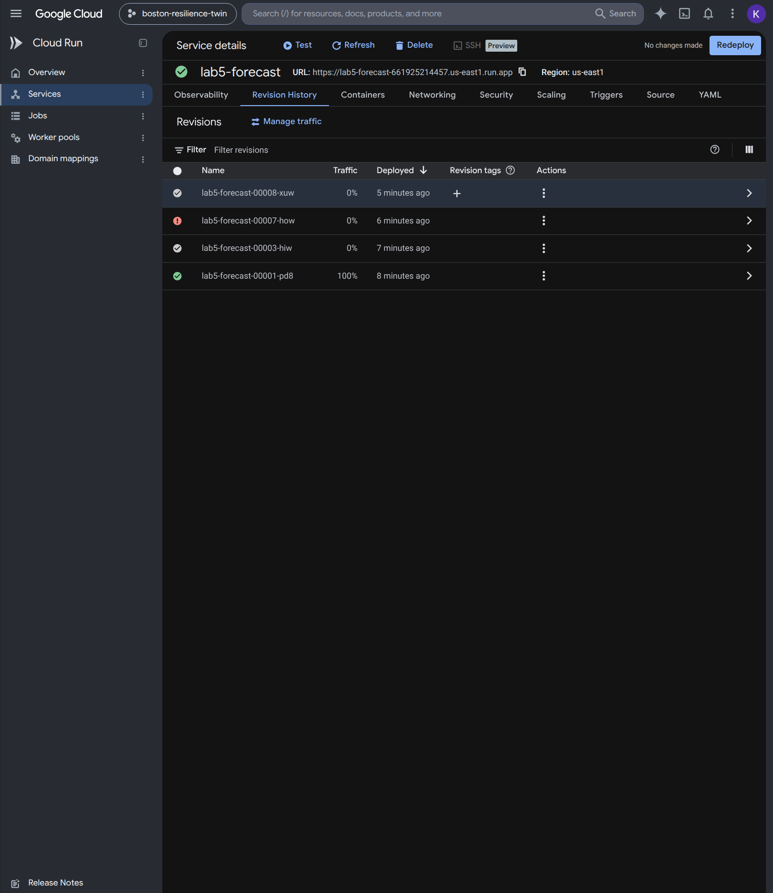
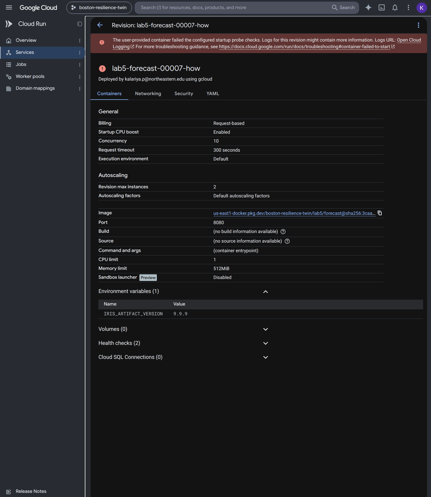
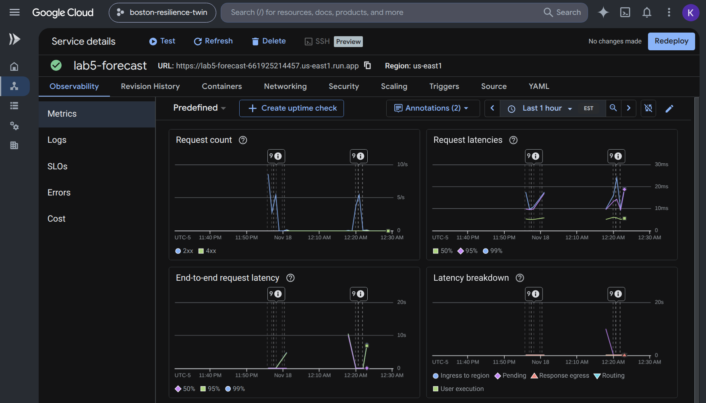

# Lab 5: Cloud Run

## What I changed

| Original | This lab | Why |
|---|---|---|
| Push to `gcr.io` (Container Registry) | Artifact Registry repo `lab5` in `us-east1`, host `us-east1-docker.pkg.dev` | Container Registry is shut down. Artifact Registry is its replacement and supports per-repo cleanup policies and labels |
| `python:3.8-slim` (end of life) running a Flask hello world, `pip install flask` unpinned (resolved to 3.0.3) | The Lab 3 FastAPI iris image: `python:3.12-slim` pinned by digest, every dependency pinned with `==`, model trained at build time and baked in, non-root user, `exec` on `$PORT` | A revision is only worth gating if it answers real predictions. Pinned inputs make two builds of the same source the same image. See `docs/baseline.md` for the stock numbers |
| Public service (`Allow unauthenticated invocations`) | Private service (`--no-allow-unauthenticated`). Callers send an identity token. No `allUsers` binding exists | A public prediction endpoint can be called, and billed, by anyone. An unauthenticated request now gets 403 |
| Runs as the project's default Compute Engine service account | Dedicated service account `lab5-run`, created with no role bindings | The container can call no Google API. Nothing it does can touch other resources in the project |
| Cloud Run's default TCP startup probe | Startup probe: HTTP GET `/health/ready`, every 2 s, 1 s timeout, 30 failures allowed (60 s). Liveness probe: HTTP GET `/health/live`, every 10 s, 1 s timeout, 3 failures | The TCP probe passes as soon as the port opens, before the model is verified. Cloud Run ignores Docker `HEALTHCHECK`, so readiness has to be declared on the service. A revision whose model fails verification is now refused (demo 2) |
| Deploy by picking an image in the Console (a tag) | Deploy by digest only (`image@sha256:...`) | A tag can be moved after it was tested. A digest names exactly the bytes that were gated |
| A new revision takes 100% of traffic immediately | A new revision ships at 0% behind the tag `cand`. The gate runs against the tagged URL. Then 10% canary, then 100%. A failed canary puts traffic back | Bad revisions are caught before users see them: by the platform (demo 2), by the gate (demo 3), or by the canary |
| No rollback step | `deploy.rollback` moves 100% of traffic to a named earlier revision and checks readiness | Rolling back is one command, and it refuses a revision that is not Ready |
| Console defaults for concurrency and scaling | Concurrency 10, 1 vCPU, 512 Mi, `--min-instances 0`, `--max-instances 2`, label `purpose=lab5` on every resource | Idle cost stays at zero and a traffic spike cannot run up the bill |
| Images accumulate forever | Cleanup policy: keep the 5 most recent versions, delete untagged versions older than 1 day | Registry storage stays under the 0.5 GB free tier |

## Overview

The course lab (`Labs/GCP_Labs/Cloud_Runner_Labs/Begineer_Lab` in `raminmohammadi/MLOps`) builds a Flask hello world on `python:3.8-slim`, pushes it to `gcr.io`, and deploys it from the Console as a public Cloud Run service. This lab rebuilds it around the Lab 3 image (the Lab 2 FastAPI iris model) and adds a release process instead of a single deploy.

Cloud Run concepts exercised:
- **Revisions:** every deploy creates an immutable revision; traffic is routed to revisions by percentage.
- **Traffic splitting and tags:** a tagged revision gets its own URL at 0% traffic, so it can be tested before it serves anyone; a 90/10 split is the canary.
- **Probes:** the startup probe decides whether a revision is ever allowed to serve; the liveness probe restarts a wedged instance.
- **IAM:** the service is private and invoked with an identity token; the container runs as a dedicated service account with no roles.

The deploy tool (`deploy/deploy.py`) deploys the new revision at 0% under the tag `cand`, gates the tagged URL (readiness, 5 golden predictions, model version, 200 requests at concurrency 5 within a p95 limit), sends 10% of traffic to it while checking 100 requests, and then promotes it. The rollback tool (`deploy/rollback.py`) moves 100% to a chosen earlier revision.

## Prerequisites

- Ubuntu 26.04.1 LTS
- Docker Engine 29.10.0
- Python 3.14.4 (the tool uses only `httpx` and `pytest`)
- Google Cloud CLI 594.0.0, logged in with `gcloud auth login`
- A GCP project with billing enabled and a budget alert. The scripts use project `boston-resilience-twin` and region `us-east1`; both are constants in `deploy/config.py` and `scripts/common.sh`
- Deployer roles: Cloud Run Admin, Artifact Registry Admin, Service Account Admin, and Service Account User (or Owner)
- No service account keys or other secrets. Identity tokens come from `gcloud auth print-identity-token` when needed and are never written anywhere

## Setup

```bash
git clone https://github.com/PritKalariya/mlops-labs.git
cd mlops-labs/lab5-cloud-run
python3 -m venv .venv
source .venv/bin/activate
pip install -r requirements.txt
cp .env.example .env
pytest -q
./scripts/setup_cloud.sh
```

`.env` holds the gate limit and request counts, no secrets. `setup_cloud.sh` is safe to repeat: it enables the Cloud Run and Artifact Registry APIs if they are off, creates the repo `lab5` with its cleanup policy, creates `lab5-run` (no roles), and registers the Docker credential helper for `us-east1-docker.pkg.dev` if it is not registered yet.

## Run

Every command runs from `lab5-cloud-run/` with the venv active. `build_push.sh` prints the pushed image reference by digest as its last line.

**v1, first release.** No service exists yet, so it goes to 100% and the gate runs on the service URL. Expected exit code 0.
```bash
V1=$(./scripts/build_push.sh v1 1.0.0 | tail -1)
python -m deploy.deploy --image "$V1" --expect-version 1.0.0
```

**Demo 1, good promote (v2).** The same training with a new model version. Gate passes, canary passes, v2 gets 100%. Expected exit code 0.
```bash
V2=$(./scripts/build_push.sh v2 1.1.0 | tail -1)
python -m deploy.deploy --image "$V2" --expect-version 1.1.0
```

**Demo 2, refused by Cloud Run (v3).** The v2 image with an expected model version it does not have. The loader raises during the app's startup, the container exits with code 3 before it serves anything, and the startup probe never passes, so Cloud Run refuses the revision. Traffic stays on v2. Expected exit code 2.
```bash
python -m deploy.deploy --image "$V2" --expect-version 1.1.0 --env IRIS_ARTIFACT_VERSION=9.9.9
```

**Demo 3, refused by the gate (v4).** The serving code swaps two request features (a training and serving skew bug). Probes pass, golden predictions do not. First prove it locally; the check exits 3:
```bash
./scripts/make_bad_image.sh
IMAGE=us-east1-docker.pkg.dev/boston-resilience-twin/lab5/forecast
docker run -d --name lab5-bad -p 18082:8080 "$IMAGE:v4"
sleep 6
python -m deploy.gate --url http://127.0.0.1:18082 --expect-version 1.2.0 --skip-load
docker rm -f lab5-bad
```
Then ship it. The `cand` tag is removed and traffic stays on v2. Expected exit code 3:
```bash
V4="$IMAGE@$(docker push "$IMAGE:v4" | sed -n 's/.*digest: \(sha256:[0-9a-f]\{64\}\).*/\1/p' | tail -1)"
python -m deploy.deploy --image "$V4" --expect-version 1.2.0
```

**Demo 4, rollback.** Move 100% back to the oldest revision (v1). `--to` is required: the rollback target is always named, never guessed, and running `deploy.rollback` without it exits with a usage error before any gcloud call. Readiness on the service URL returns 200. Expected exit code 0.
```bash
V1_REV=$(gcloud run revisions list --service lab5-forecast --project boston-resilience-twin \
  --region us-east1 --format='value(metadata.name)' --sort-by=metadata.creationTimestamp | head -1)
python -m deploy.rollback --to "$V1_REV"
```

Call the service directly:
```bash
URL=$(gcloud run services describe lab5-forecast --project boston-resilience-twin --region us-east1 --format='value(status.url)')
curl -s -H "Authorization: Bearer $(gcloud auth print-identity-token)" "$URL/health/ready"; echo
curl -s -o /dev/null -w '%{http_code}\n' "$URL/health/ready"   # no token: 403
```

## Expected result

All numbers are measured and listed in `docs/results.md`.

| Step | Exit code | Traffic after |
|---|---|---|
| v1 first release | 0 | v1 100% |
| Demo 1, good promote | 0 | v2 100% |
| Demo 2, refused by Cloud Run | 2 | v2 100% (unchanged) |
| Demo 3, refused by the gate | 3 | v2 100% (unchanged, `cand` removed) |
| Demo 4, rollback | 0 | v1 100% |

- Image: 141.5 MB compressed in Artifact Registry for each of v1, v2 and v4; the repo holds 389.9 MB with all three, under the 0.5 GB free tier.
- Gate p95 from a laptop through the internet: 70.6 ms on v1 at first release, 70.3 ms on v2. The limit is 150 ms (2x v1, rounded up to 10 ms).
- Demo 3 on the skewed image: all 5 golden cases mismatch, locally and in the cloud.
- Startup: a revision passed its startup probe 8.2 to 10.4 s after its instance started (5 to 6 attempts at a 2 s period); the stock Flask hello world took 1.79 s. Cold start after 15 minutes idle: first request 10.44 s at the client, and 10.24 s from instance start to startup probe pass.
- Unauthenticated request: 403. `get-iam-policy` shows no bindings.

Screenshots, taken from the Cloud Run Console after the run:

**Revisions tab of `lab5-forecast`:** v1 at 100%, the refused revision in red, v2 and the gate-refused v4 Ready at 0%.



**The refused revision:** its failed startup probe, the wrong `IRIS_ARTIFACT_VERSION`, and the image pinned by digest.



**Metrics tab:** request count and latency for both runs.



## Clean up

```bash
./scripts/teardown.sh
```

It deletes the services `lab5-forecast` and `lab5-hello` (revisions go with them), the `lab5` repo (images go with it), the `lab5-run` service account (after listing its keys; only Google-managed keys may exist), local `lab5` images and containers, and `/tmp/lab5-clean` and `/tmp/lab5-baseline`. It then prints the proof commands below; each prints nothing:

```bash
gcloud run services list --project boston-resilience-twin --region us-east1 --filter='metadata.name ~ ^lab5-' --format='value(metadata.name)'
gcloud artifacts repositories list --project boston-resilience-twin --location us-east1 --filter='name ~ /lab5$' --format='value(name)'
gcloud iam service-accounts list --project boston-resilience-twin --filter='email ~ ^lab5-' --format='value(email)'
docker image ls --format '{{.Repository}}:{{.Tag}}' | grep -E 'lab5|pkg.dev/boston-resilience-twin/lab5'
```

The service account listing can show `lab5-run` for a few seconds after its deletion; run the command again and it comes back empty.

Cost of leaving everything up: Cloud Run at min instances 0 bills only while handling requests, so an idle service costs nothing and this lab stays inside the free tier. Images are free under 0.5 GB of Artifact Registry storage, then $0.10 per GB-month. A service account is free. The enabled APIs stay enabled; that costs nothing.

## Known limitations

- The gate runs from a laptop, so its p95 includes the network round trip. The 150 ms limit comes from one network; on a slower connection, rerun v1, measure, and set `GATE_P95_MS` to 2x the result rounded up to 10 ms.
- The canary check is request-count based, not time-based: 100 requests with zero non-2xx, not a window of minutes. It does not confirm the new revision was among the instances that answered.
- A refused startup shows up in Cloud Logging as a container that exited, not as repeated probe failures. When the loader raises at startup, the process exits with code 3 within a second, the startup probe never gets a 200 from `/health/ready`, and Cloud Run marks the revision not Ready with the message that it failed the configured startup probe checks.
- After a refused deploy (demo 2 or demo 3), the service template still names the refused image. Any `gcloud run services update` creates a new revision from that template, and `--to-latest` routes traffic to the newest Ready revision, which after demo 3 is the gate-refused v4. Release only through `deploy.deploy`, by digest, with traffic pinned to named revisions, and use `deploy.rollback --to` to move traffic back.
- Cloud Run names revisions with a counter that every traffic update also advances, so revision numbers are not consecutive.
- Logs stay in Cloud Logging for its retention period after teardown.
- The Cloud Run execution environment is left at its default (not set).
