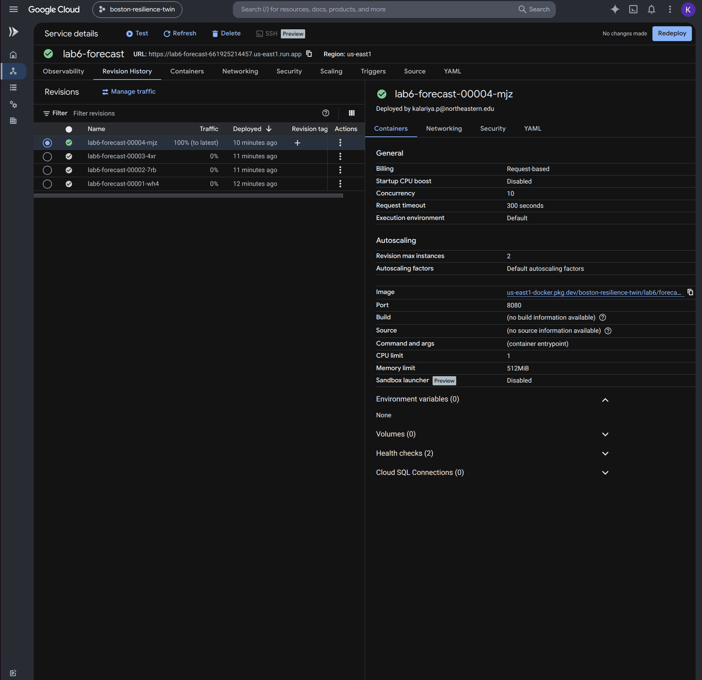
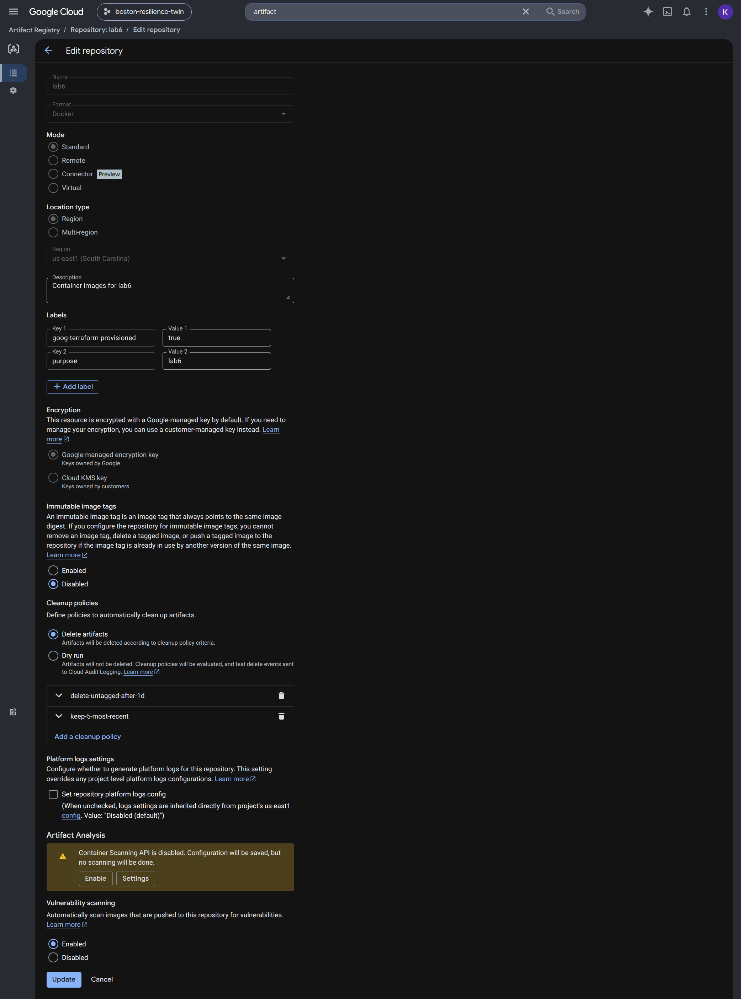
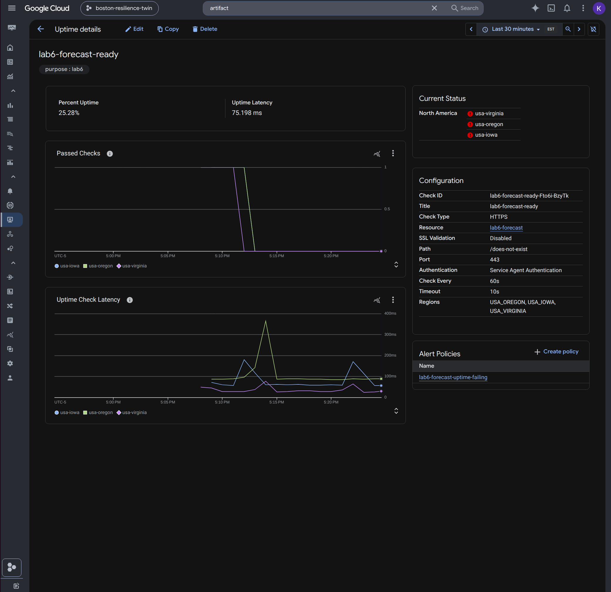
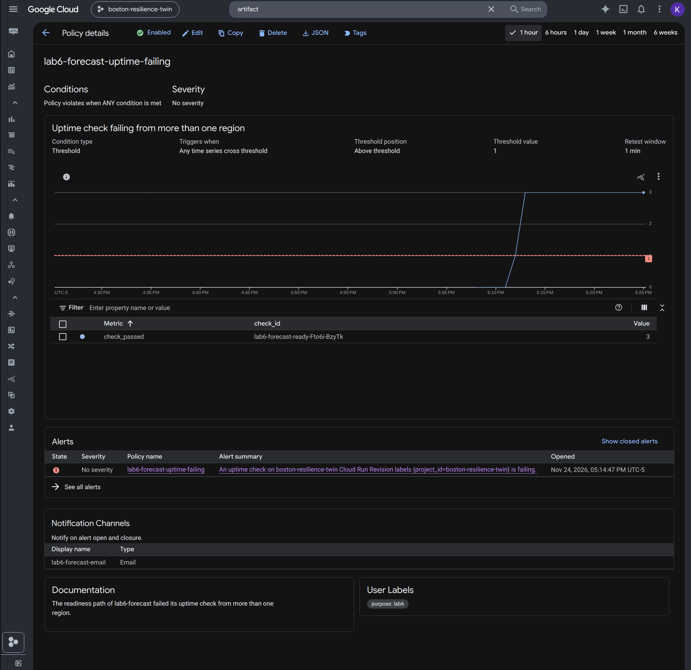

# Lab 6: a tested Terraform module for a private Cloud Run service

The course lab (`Labs/Terraform_Labs/GCP/Lab1_Beginner`) writes one flat `main.tf` that creates a VM and a bucket, edits them, and destroys them. This lab rebuilds the exercise as two modules, two root stacks with separate state, and a test suite, and uses them to deploy the Lab 5 forecast service as a private Cloud Run service with an uptime check and an email alert.

## What I changed

| Original | This lab | Why |
|---|---|---|
| One flat `main.tf` | `modules/registry` and `modules/serving`, called from `stacks/registry` and `stacks/serving` | Modules are reusable and testable; the stacks hold the lab-specific values |
| No `terraform {}` block, provider floats (resolved to 8.12.0 in `docs/baseline.md`) | Roots pin `required_version = "= 1.17.2"` and `hashicorp/google = "= 8.12.0"`; modules declare minimums (`>= 1.7`, `>= 6.0`); lock files are committed | The same plan on every machine; a provider upgrade becomes a reviewed change |
| Editor service account with a downloaded JSON key | Application default credentials from `gcloud auth application-default login`; no keys anywhere | A key on disk is a standing credential. A user login expires and leaves nothing behind |
| An `f1-micro` VM and a bucket | An Artifact Registry repo, and a private Cloud Run service with a no-role runtime service account, an uptime check, an alert policy and an email channel | A VM and a bucket exercise Terraform; a deployed service also exercises ownership, validation and monitoring |
| One state | Separate state for `registry` and `serving` | The image has to be pushed between the two applies. With separate stacks no `-target` is needed |
| Terraform owns everything | Terraform owns the service's shape; `gcloud run deploy` owns the image and traffic, through a narrow `lifecycle { ignore_changes }` | A release tool changes the image on every release; Terraform must not revert it, and must still catch drift in everything else |
| No input checks | Variable validation and a precondition reject a tag image, `max_instances` outside 1 to 3, `concurrency` outside 1 to 80, warm instances without `allow_warm`, labels without `purpose`, and public invokers | Unsafe settings fail at plan time with a message that says what to do |
| No tests | `terraform test` in plan mode with `mock_provider`: 8 runs, offline, no credentials | The contract is checked on every change without creating anything |
| No monitoring | An OIDC uptime check on `/health/ready` every 60 s, an alert policy on its pass metric, and an email channel | A failing readiness path becomes an incident and an email |
| `us-central1`, `us-central1-a`, no labels | `us-east1`; `purpose=lab6` on every resource that supports labels | Same region as Lab 5; every resource can be found and removed by its label |

## Overview

```
stacks/registry  ->  modules/registry   Artifact Registry repo "lab6" with a cleanup policy
                                        (keep the 5 most recent versions; delete untagged versions older than 1 day)

scripts/build_push.sh                   builds lab5-cloud-run/app, pushes it, prints the image digest

stacks/serving   ->  modules/serving    runtime service account "lab6-run" (no roles)
                                        private Cloud Run service "lab6-forecast" (concurrency 10, min 0, max 2,
                                          1 CPU, 512Mi, startup probe /health/ready, liveness probe /health/live)
                                        Monitoring service agent: roles/run.invoker on this service only
                                        uptime check "lab6-forecast-ready" (OIDC, every 60 s, 3 US regions)
                                        alert policy "lab6-forecast-uptime-failing" + email channel
```

Files: `modules/serving/tests/serving.tftest.hcl` (tests), `scripts/teardown.sh` (destroy serving, then registry), `docs/baseline.md` (the course lab run as written), `docs/results.md` (measurements).

## Prerequisites

- Ubuntu 26.04.1 LTS (any Linux or macOS shell works), Terraform 1.17.2, gcloud 594.0.0, Docker 29.10.0, `curl`, `python3`.
- A GCP project with billing enabled and a budget alert. The project id `boston-resilience-twin` and region `us-east1` are set in `locals` at the top of `stacks/*/main.tf` and in `scripts/build_push.sh`; change all three places to use another project.
- Roles for the user running Terraform: Owner. Narrower roles (Cloud Run Admin, Artifact Registry Administrator, Service Account Admin, Service Account User, Monitoring Editor, Service Usage Consumer) were not tested.
- The Lab 5 app in `../lab5-cloud-run/app`, which is the image build source.
- No service account keys.

## Setup

```bash
gcloud auth login
gcloud auth application-default login
gcloud services enable run.googleapis.com artifactregistry.googleapis.com \
  monitoring.googleapis.com iam.googleapis.com --project boston-resilience-twin
gcloud auth configure-docker us-east1-docker.pkg.dev

cd lab6-terraform
cp stacks/serving/terraform.tfvars.example stacks/serving/terraform.tfvars
# edit stacks/serving/terraform.tfvars and set alert_email to an address you can read
```

`terraform.tfvars` is gitignored. Verify the offline tests before creating anything:

```bash
cd modules/serving
terraform init -backend=false
env -u GOOGLE_APPLICATION_CREDENTIALS -u GOOGLE_OAUTH_ACCESS_TOKEN CLOUDSDK_CONFIG=$(mktemp -d) terraform test
cd ../..
```

## Run

Every apply uses a saved plan, so the plan summary can be read first.

### 1. Registry and the first image

```bash
cd stacks/registry
terraform init
terraform plan -out=lab6.tfplan          # Plan: 1 to add
terraform apply lab6.tfplan
cd ../..

V1=$(scripts/build_push.sh v1)           # stdout is only the image digest reference
echo "$V1"
```

### 2. Serving

```bash
cd stacks/serving
echo "image = \"$V1\"" >> terraform.tfvars
terraform init
terraform plan -out=lab6.tfplan          # Plan: 6 to add
terraform apply lab6.tfplan

URL=$(terraform output -raw service_url)
curl -s -o /dev/null -w '%{http_code}\n' "$URL/health/ready"     # 403 (private)
curl -s -w '\n%{http_code}\n' -H "Authorization: Bearer $(gcloud auth print-identity-token)" \
  "$URL/health/ready"                                            # 200
```

### Demo 1: ownership split (expected plan exit 0)

```bash
V2=$(../../scripts/build_push.sh v2 v2)       # same code, label lab6.build=v2, new digest
gcloud run deploy lab6-forecast --image "$V2" --project boston-resilience-twin --region us-east1
terraform plan -detailed-exitcode             # exit 0: the new image is not reverted
curl -s -H "Authorization: Bearer $(gcloud auth print-identity-token)" "$URL/health/ready"
gcloud run services describe lab6-forecast --project boston-resilience-twin --region us-east1 \
  --format='value(status.latestReadyRevisionName,spec.template.spec.containers[0].image)'   # the v2 digest
```

### Demo 2: drift is still caught (expected exits 2, then 0)

```bash
gcloud run services update lab6-forecast --max-instances 3 \
  --project boston-resilience-twin --region us-east1
terraform plan -detailed-exitcode -out=lab6.tfplan   # exit 2: max_instance_count = 3 -> 2
terraform apply lab6.tfplan
terraform plan -detailed-exitcode                    # exit 0
```

### Demo 3: validation at plan time (expected: three failures, nothing changes)

```bash
terraform plan -var 'image=us-east1-docker.pkg.dev/boston-resilience-twin/lab6/forecast:v1'   # exit 1
terraform plan -var max_instances=10                                                          # exit 1
terraform plan -var 'invoker_members=["allUsers"]'                                            # exit 1
terraform plan -detailed-exitcode                                                             # exit 0
```

### Demo 4: the alert (expected: an incident opens, then closes)

```bash
terraform plan -out=lab6.tfplan -var uptime_path=/does-not-exist     # Plan: 1 to change
terraform apply lab6.tfplan
```

The check starts failing about two minutes later (configuration changes take time to reach the checkers). Watch Console, Monitoring, Alerting, or read the log:

```bash
gcloud logging read 'logName:"ViolationOpenEventv1" AND "lab6-forecast-uptime-failing"' \
  --project boston-resilience-twin --freshness=30m --format='value(timestamp)'
```

The email goes to `alert_email` when the incident opens. Then restore the path:

```bash
terraform plan -out=lab6.tfplan          # path /does-not-exist -> /health/ready
terraform apply lab6.tfplan
gcloud logging read 'logName:"ViolationAutoResolveEventv1" AND "lab6-forecast-uptime-failing"' \
  --project boston-resilience-twin --freshness=30m --format='value(timestamp)'
```

## Expected result

Numbers below are from `docs/results.md`.

- `terraform test`: 8 passed, 0 failed, with credentials hidden.
- Plans: `registry` 1 to add; `serving` 6 to add.
- `gcloud run services describe`: startup probe `/health/ready` (period 2 s, timeout 1 s, threshold 30), liveness probe `/health/live` (period 10 s, timeout 1 s, threshold 3), concurrency 10, min 0, max 2, 1 CPU, 512Mi, service account `lab6-run`, label `purpose=lab6`. The IAM policy has one member, the Monitoring service agent.
- Unauthenticated `curl`: 403. With an identity token: 200.
- Demo 1: plan exit 0 with revision 2 serving v2. In a copy with `ignore_changes` removed, the same plan shows the image reverting to v1 (the line is in `docs/results.md`).
- Demo 2: plan exit 2 (`3 -> 2`), then exit 0 after apply.
- Demo 3: three plans exit 1, one message each; a clean plan exits 0 afterwards.
- Demo 4: the first failing datapoint appeared 2 min 6 s after the broken path was applied; the incident closed 3 min 52 s after the path was restored.
- Cleanup policy: `keep-5-most-recent` (keep count 5) and `delete-untagged-after-1d` (untagged, older than 86400 s), dry run disabled.









## Clean up

```bash
scripts/teardown.sh        # destroys serving, then registry; asks to confirm each; safe to run again
```

Cost if left running: the registry repo is free under 0.5 GB (about 300 MB with two images); Cloud Run at minimum 0 bills only during requests, and the uptime pings cost cents a day; the uptime check (about 130,000 executions a month) is free under 1,000,000; the alert policy has no charge today; the service account and channel are free.

Prove deletion (each prints nothing):

```bash
P=boston-resilience-twin
gcloud run services list --project $P --region us-east1 --filter='metadata.name ~ ^lab6-' --format='value(metadata.name)'
gcloud artifacts repositories list --project $P --location us-east1 --filter='name ~ /lab6$' --format='value(name)'
gcloud iam service-accounts list --project $P --filter='email ~ ^lab6-' --format='value(email)'
gcloud monitoring uptime list-configs --project $P --filter='displayName ~ ^lab6-' --format='value(displayName)'
gcloud alpha monitoring policies list --project $P --filter='displayName ~ ^lab6-' --format='value(displayName)'
gcloud beta monitoring channels list --project $P --filter='displayName ~ ^lab6-' --format='value(displayName)'
```

Enabled APIs stay enabled (free). The Monitoring service agent that the first uptime check creates also stays; it has no roles once the service is gone.

## Known limitations

- State is local: no locking, no sharing. A remote backend would fix both and was left out to keep the lab self-contained.
- Alert timing depends on Monitoring: a configuration change reaches the checkers after about two minutes, and an incident opens and closes after the evaluation delay.
- The email channel notifies when an incident opens. Correcting the address while an incident is open does not resend; the incident has to close and reopen.
- The uptime check runs from three US regions to keep executions low, and the alert fires when more than one region fails.
- Service-agent (OIDC) authentication is only accepted for a `cloud_run_revision` check, not for an `uptime_url` check. The API returns two label keys of that resource as null, so `ignore_changes` covers exactly those two keys.
- `traffic` is in `ignore_changes` because the release tool splits traffic during canary and rollback. With no `traffic` block in the configuration, removing it from the list produced no diff in this lab, so it is a guard rather than a proven need.
- The module creates the uptime check before the invoker binding, because binding the role to the Monitoring service agent fails with "does not exist" until that agent has been created. The order was verified only in a project where the Monitoring service agent already existed. It was not tested from a project that has never had an OIDC uptime check.
- Traffic always goes to the latest revision. The module sets no `traffic` block, so the service takes the provider default of 100% to latest, and `traffic` is then ignored. A `gcloud run deploy` therefore shifts all traffic at once. A release tool that needs a canary or a rollback must pin revisions by name instead.
- Startup CPU boost is off (`startup_cpu_boost = false`). The Lab 5 service had it on, so cold-start times from this lab are not comparable with Lab 5's.
- The lock files hold hashes for the platform they were created on (`linux_amd64`); another platform records its own hashes on the first `terraform init`.
- The build depends on `../lab5-cloud-run/app`.
